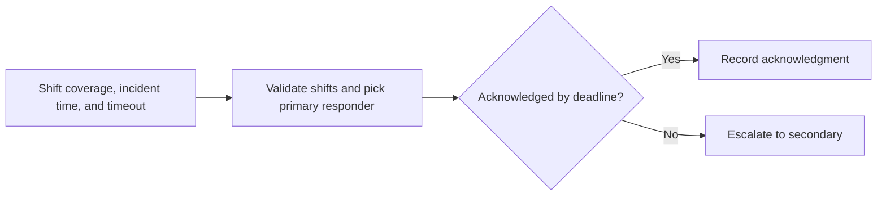

# On-call rotation lab

An escalation near a shift change needs a reproducible answer for who receives the page and when secondary coverage is used.

## What I built

I built an offline rotation simulator that validates shift coverage, picks responders at incident start, and traces paging, escalation, and acknowledgment as separate events. An acknowledgment by the deadline prevents escalation.

## How it works



[Architecture](docs/ARCHITECTURE.md) · [Decision rules and source](docs/RULES.md)

## Tools used

| Tool | Role in this repository |
| --- | --- |
| Python | [rotation.py](rotation.py) implements the CLI and decision rules. Uses `argparse` to parse command-line options, `dataclasses` to represent shift assignments. |
| Make | Runs the documented example and the local `unittest` suite. |
| Python replay runner | Compares actual stdout with the checked-in baseline fixtures. |
| Ruff and Bandit | Developer lint and static security checks through `make check`. |

## Run the project

Use Python 3.10+ and Make. From the repository root:

```sh
python3 rotation.py --incident 59 --timeout 5 --ack 65
```

The sample pages Alex at minute 59, escalates to Sam at 64, and records Sam's acknowledgment at 65. [Full expected output](examples/Demo%201.stdout.txt)

## Verify the project

```sh
make verify
make replay
```

`make replay` checks the recorded cases and exits nonzero if the output changes.
See the [developer guide](docs/DEVELOPMENT.md) for the pinned lint and security tools.

## Operating limits

The CLI uses synthetic shifts and relative minutes. It does not handle time zones or send live pages.

[Case study](docs/CASE_STUDY.md) · [Operator runbook](docs/RUNBOOK.md) · [Verification report](reports/verification.md)
