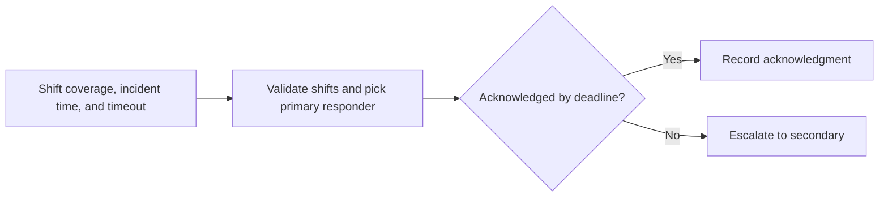

# On-call rotation lab

A local simulator for PagerDuty-style primary and secondary escalation using synthetic responders. It makes shift boundaries and acknowledgment timing explicit.

## Quick start

With Python 3.10 or newer:

```sh
python3 rotation.py --incident 59 --timeout 5 --ack 65
python3 -m unittest -v
```

The example pages Alex at minute 59, escalates to Sam at 64, and records acknowledgment at 65. Incidents retain the responders assigned at incident start. An acknowledgment at the deadline suppresses escalation.

The simulator runs offline, stores no incident state, and never sends a real page. Live PagerDuty integration and time zones are outside its scope.

## Local verification

Run `make verify` with Make and Python 3 installed. The target runs the documented sample through the project CLI. It also runs the existing Python unit tests.

## Business problem

An escalation near a shift change needs a reproducible answer for who receives the page and when secondary coverage is used.

## Project walkthrough



[Architecture and data flow](docs/ARCHITECTURE.md) · [Business problem, demo, and verification](docs/CASE_STUDY.md)

## Run the project

### Local setup

Run `make verify` with Python 3 and Make installed.

### CLI usage

```sh
python3 rotation.py --incident 59 --timeout 5 --ack 65
```

### Replay usage

Run `make replay` to replay the checked-in inputs. The runner compares stdout with the baseline, reports differences, and exits nonzero on regression.

[Replay cases](examples/replay-manifest.json) · [Generated report](reports/replay.md) · [Rule implementation](docs/RULES.md)

### Run tests

[Verification report](reports/verification.md) · [Business problem, sample behavior, and limitations](docs/CASE_STUDY.md)


### Limitations

The verification report covers the bundled local examples. See the [case study](docs/CASE_STUDY.md) for project-specific assumptions and operating limits.
