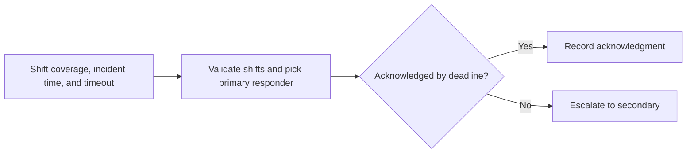

# On Call Rotation Lab architecture

A local simulator for PagerDuty-style primary and secondary escalation using synthetic responders. It makes shift boundaries and acknowledgment timing explicit.

## Operational boundaries

The documented run evaluates the bundled sample locally. Results depend on the quality and scope of the input. The demo makes no live infrastructure changes.
